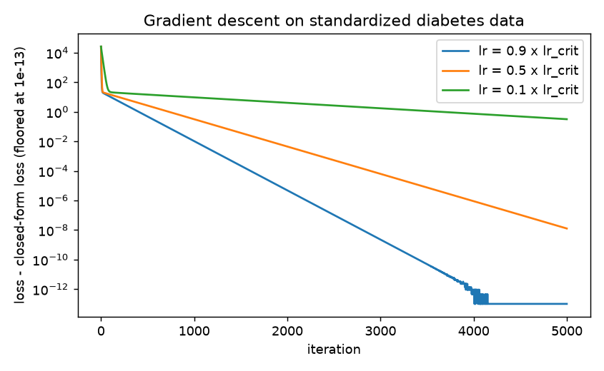
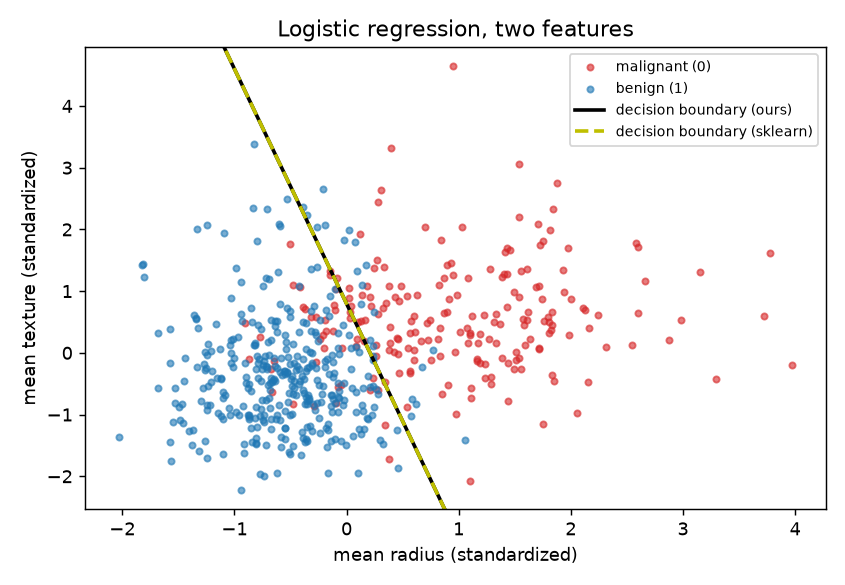
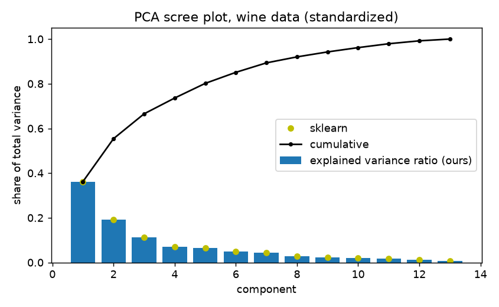

# ML from scratch

Linear regression, logistic regression and PCA implemented with NumPy only, each with its mathematical derivation written out. **17/17 tests pass**, and on open datasets the results match scikit-learn to about 1e-12 (closed-form linear and ridge regression), 1e-6 (gradient-descent logistic regression) and 1e-15 (PCA).

## Why this repo exists
To show how each model works inside, not only how to call a library. Each model has a step-by-step derivation in `docs/`, a NumPy implementation in `mlscratch/`, tests (including a finite-difference gradient check), and a numerical comparison with scikit-learn in a notebook. scikit-learn is used **only** in the notebook, as a reference.

## Who did what
This project was written with AI assistance. Be clear about who did what:
- **AI assistant (Claude):** the function stubs and the 17 tests (provided together as the initial scaffold, in a single session), then the implementations in `mlscratch/`, the derivations in `docs/`, the comparison notebook and this README. The derivations were checked numerically against the code (gradient vs finite differences, gradient descent vs closed form, and so on); the checks are listed at the end of each doc.
- **Repository owner (Yuldoshev Temurbek):** set the goals and directed the work, made the decisions, created the GitHub account and repository. The code and text in this repository were not written by hand by the owner.
- The tests in `tests/` were not edited to make the code pass.
- **Time frame:** the scaffold, implementations, derivations, notebook and this README were produced in AI-assisted working sessions on 2026-11-02 and 2026-11-03, so the commit history is short. It is not the record of a multi-week project.

## Results
All numbers are produced by `notebooks/compare-with-sklearn.ipynb` (Windows, Python 3.13.5, NumPy 2.4.4, scikit-learn 1.9.1). Comparisons are on the full datasets: they check that the implementations agree, not how well the models generalize.

| Model and dataset | What is compared | Difference |
|---|---|---|
| Linear regression (OLS), `load_diabetes` | max abs prediction difference vs `LinearRegression` | 7.7e-13 |
| Linear regression (OLS), `load_diabetes` | abs MSE difference (MSE = 2859.696348) | 4.5e-13 |
| Ridge, alpha = 1 and 10, `load_diabetes` | max abs prediction difference vs `Ridge` | 1.1e-13, 8.5e-14 |
| Gradient descent (lr = 0.9 x 2/lambda_max, 5000 iterations), standardized `load_diabetes` | max abs weight difference vs our closed form | 1.7e-7 |
| Logistic regression (20 000 iterations), standardized `load_breast_cancer` | max abs weight difference vs `LogisticRegression` | 2.1e-6 |
| Logistic regression (20 000 iterations), standardized `load_breast_cancer` | max abs probability difference; predicted labels | 5.6e-7; identical (training accuracy 0.9877 for both) |
| PCA, standardized `load_wine` | explained variance; components (abs cosine); scores | 0; 1.3e-15; 8.9e-16 |

Figures (from the notebook):

| Gradient descent loss gap | Logistic decision boundary | PCA scree plot |
|---|---|---|
|  |  |  |

## Limitations
- **Gradient descent is sensitive to the learning rate.** It converges only for `lr < 2 / lambda_max(H)` (derived in `docs/01`). On standardized diabetes data, a step 1.6 times the bound diverged (loss 2.9e4 to 6.6e36 in 50 steps), and a step 0.1 times the bound had not converged after 5000 iterations (loss gap 0.32, weight error 4.3).
- **Features should be standardized for gradient descent.** On the raw diabetes features the Hessian is nearly singular, so convergence is far too slow for the default settings; the closed form does not have this problem.
- **Logistic regression needs many iterations to match L-BFGS tightly.** After 2000 iterations the largest probability difference from scikit-learn was 2.4e-2; after 20 000 it was 5.6e-7. There is no stopping rule beyond the iteration count.
- **Separable data has no finite optimum.** Without `l2 > 0` the weights keep growing slowly (logarithmically) and depend on when you stop (shown in `docs/02`). The synthetic test clusters happen to be linearly separable, so that test's fit stops at the iteration cap.
- **The logistic loss is clipped for numerical safety**, so in saturated regions the finite-difference check disagrees with the (mathematically correct) analytic gradient (explained in `docs/02`).
- **Closed-form regression forms the normal equations**, which squares the condition number; for near-collinear features a QR/SVD route would be more accurate.
- **PCA computes a full SVD** of the centered data: fine for the small datasets here, not for large ones. Only dense arrays are supported, and component signs are arbitrary.
- **Tested on one machine** (Windows, Python 3.13.5, NumPy 2.4.4). Nothing was checked on other platforms or versions.

## How to run
```
python -m pip install numpy
python -m unittest discover -s tests -v
python -m pip install -r requirements-notebook.txt   # only for the notebook
```
The notebook is `notebooks/compare-with-sklearn.ipynb` (open it from the `notebooks/` folder).

## Repository map
```
mlscratch/
  linear_regression.py       add_bias, closed form (ridge), predict, mse, gradient descent
  logistic_regression.py     stable sigmoid, log-loss, loss_and_grad, fit, predict
  pca.py                     SVD-based fit, transform, inverse_transform
tests/                       17 tests (7 linear, 6 logistic, 4 PCA)
docs/                        derivations: 01 linear, 02 logistic, 03 PCA
notebooks/                   comparison with scikit-learn, figures/
LOG.md                       work log
```
